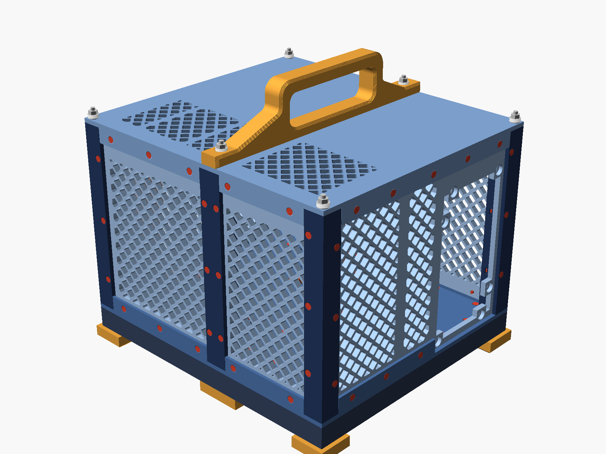
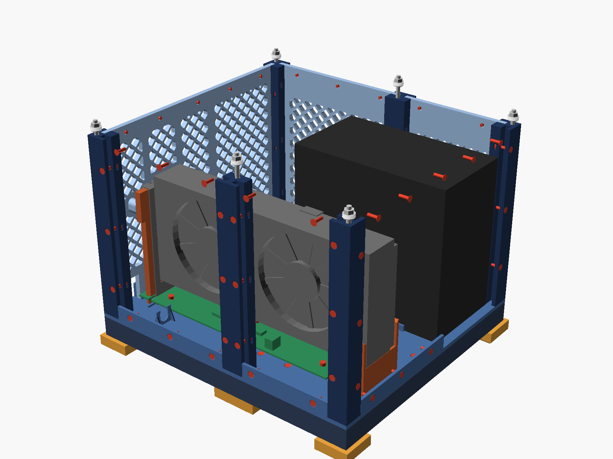
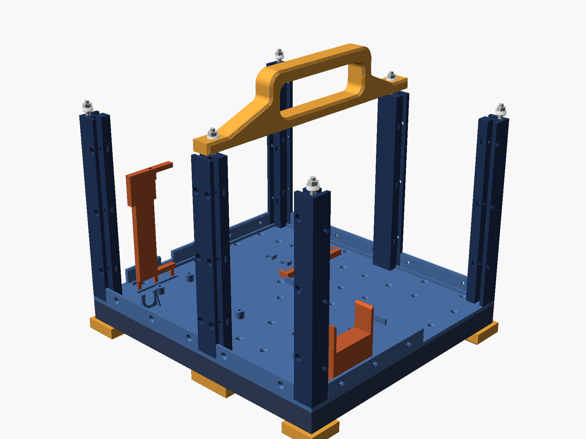
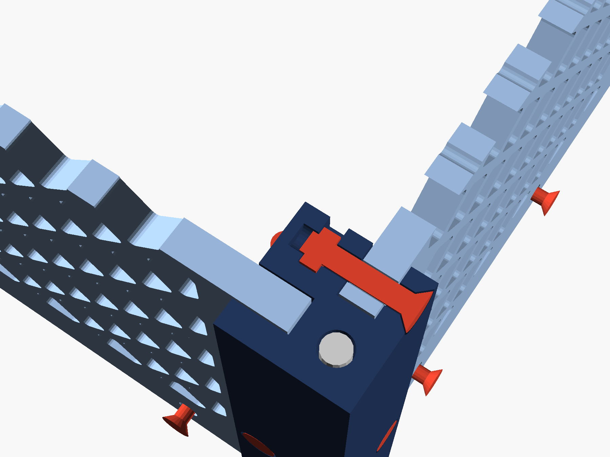
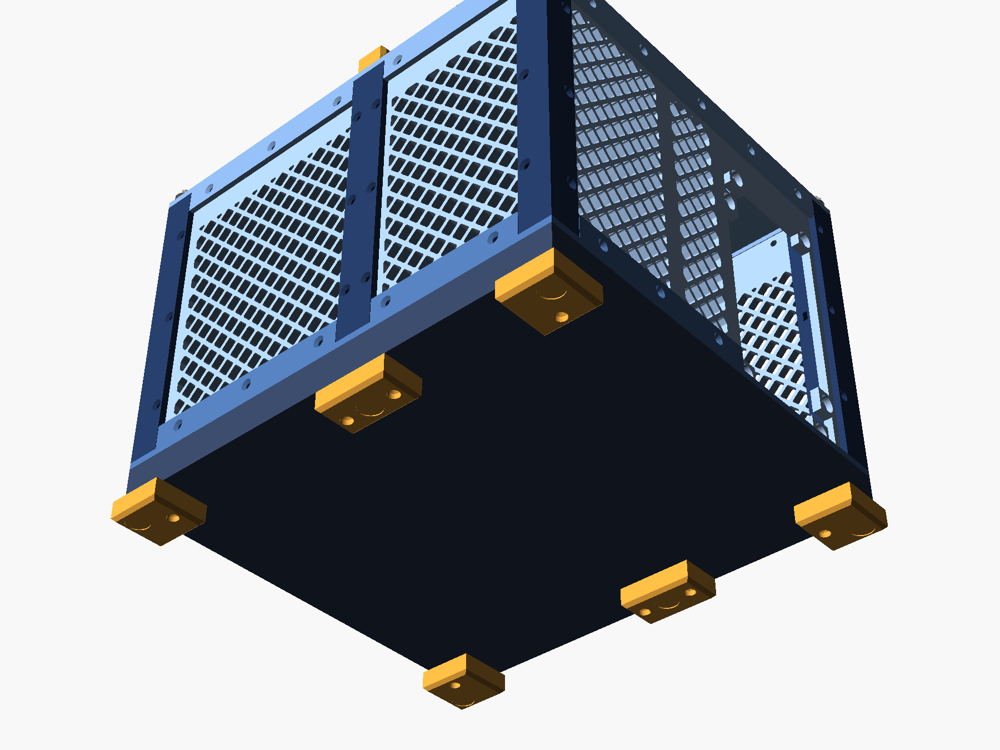
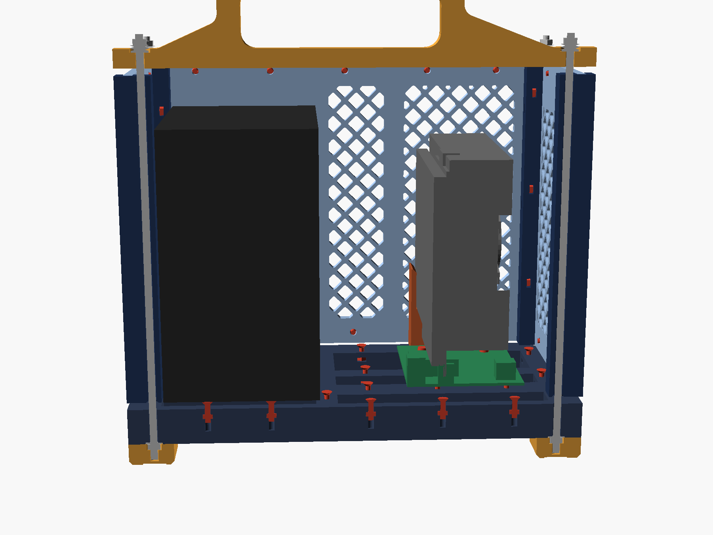
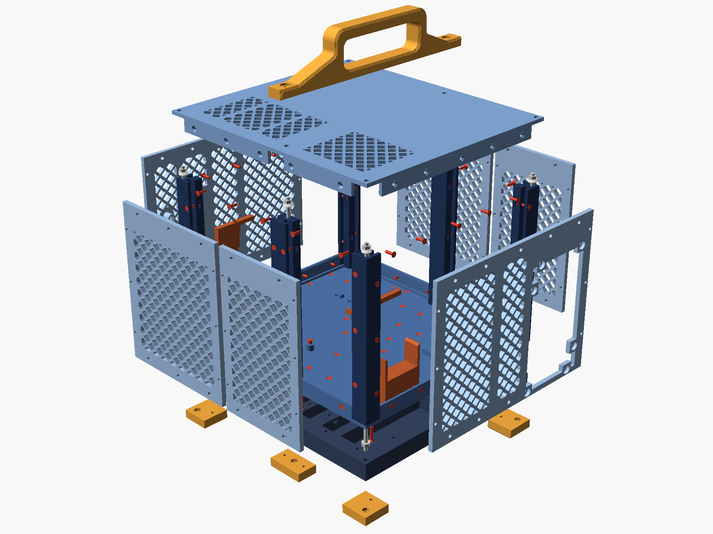

# xgm-v2: the same case, built to be stiff

A second enclosure for the hardware of [`../case`](../case): the XG Mobile Station Lite board, the
Inno3D RTX 3060 and the Corsair RM850. **It is a design study. Nothing here has been printed**, and
v1 in `../case` is still the case that is being built. This folder answers one question: what would
the case look like if stiffness came first, and size, plastic and the number of screws did not matter?

Everything inside is where v1 put it. [`hardware.scad`](hardware.scad) carries over every number
that was measured on the real parts or settled at v1's test fit, and `tools/check_hardware.sh` proves
that the two models draw the same volumes for board, card, PSU and cables. v1's bracket holder and
cradle are reused exactly as printed (`tools/check_reused.sh`: the print files are identical), so the
two parts that were fitted to the real card drop straight into this case.

## What it costs, and what it buys

| | v1 | v2 |
|---|---|---|
| Outside | 271 × 244 × 184 mm | 279 × 252 × 206 mm, 218 on its feet, 270 over the handle |
| Plastic | 0.93 kg | 1.83 kg |
| Printing | 32 h | 76 h |
| Screws | 43 M3 in inserts | 122 M3 (83 in steel nuts, 39 in inserts), 6 M4 rods, 4 PSU screws |
| Loaded weight | about 4.3 kg | about 5.4 kg |
| Floor | 3 mm plate in four jigsaw pieces | closed sandwich 24 mm deep, 264 times stiffer in bending |
| Walls | 3 mm, slid into posts | 5 mm, bolted along all four edges |
| A vented wall in shear | 4 % of the solid wall | 32 %, with more open area (57 % against 42 %) |
| Carried by | two M3 inserts in the tops of two posts | two M4 rods that run down to the feet |

The numbers are hand calculations (`tools/numbers.py` prints them all, with the formulas in plain
sight), not a simulation, and nothing has been tested on a print. Weights and times are real slices
of these files (`tools/slice.py`).

## How it carries load

1. **Six steel tie rods.** An M4 threaded rod runs through each post, from a nut held in a foot
   under the case to a nut on top of the lid. Whatever pulls the case apart pulls on steel; the
   printed parts between the two nuts are only ever squeezed, which is the one thing a print is good
   at in every direction. Four disc springs under each top nut keep the squeeze roughly constant:
   PETG grows five times as much as steel when it warms up, and creeps under load, and without the
   springs a rod would lose its whole preload to 0.2 mm of creep.
2. **A closed base.** Under the floor plate lies a tray 20 mm deep: a 2 mm sole with a grid of rails
   standing on it. The plate is bolted down onto the rails with 34 countersunk screws, each into a
   steel nut slid into a slot of the rail. Sole, rails and plate then work as one box section 24 mm
   deep. Hung from the handle with PSU and card on it, it sags about 0.02 mm; v1's floor, on the same
   sums and treated generously as one seamless plate, sags 5.6 mm.
3. **Every edge of every wall is bolted.** Each panel's two ends stand in slots in the posts and are
   held by three screws that go through post, panel and into a nut in the post's core. Its bottom
   edge is screwed to a rim that stands up from the floor, its top edge to a rim that hangs down from
   the lid. Floor, walls and lid are one closed box, and a closed box is what resists twisting: by the
   thin-wall formula, 60 N on one corner moves that corner 0.05 mm, as long as no joint slips.

   
4. **Lattice vents.** v1's vents are fields of slots, and the strips between slots carry shear only
   by bending: a slotted field keeps about 4 % of the solid wall's shear stiffness. Here every vent is
   a lattice of bars at 45° both ways, which carry shear as struts and ties and keep 32 %. The holes
   are 7.6 mm squares on their corners.
5. **The handle is a beam on two of the rods.** It lies across the lid from one long wall's mid post
   to the other's, and those two posts' rods come up through its ends. A lift goes hand, beam, two
   rods, two feet, base: the lid and the walls are not in it. The beam is printed on its side so that
   its layers run along the load; at three times the loaded weight its worst stress is 2.9 MPa
   against 45.
6. **The feet are the rods' anchors.** Each foot holds the nut its rod ends in and is screwed to the
   base from below. The four corner feet stand 4 mm beyond the case all round, as bumpers.

   
7. **The PSU is fixed like in a PC.** Four of its own screws through the far wall, two guides and a
   spacer on the floor, and two pads under the lid that stop it lifting.

## Two versions

One model, two ways to cut the three big plates, chosen with `bed`:

| | `xgm-v2-350` | `xgm-v2-256` |
|---|---|---|
| For | beds of 300 × 300 mm and more: the fablab's Bambu H2D | 256 × 256 mm beds: P1S, X1C, A1 |
| Base, floor, lid | one piece each, 279 × 252 mm | two pieces each |
| Largest part | 279 × 252 mm | 206 × 252 mm |
| Screws | 122 M3 | 138 M3 |
| Sliced on | H2D profile | P1S profile, with the corner that printer keeps for itself |

In `xgm-v2-256` the three seams are at three different places along the case (base at x = 75, lid at
135, floor at 175 mm from the board's rear edge), so each seam lies under or over an unbroken plate of
the neighbouring layer and is bolted to it on both sides: the floor plate bridges the base's seam, the
base bridges the floor's. The two halves of the base are also half-lapped and bolted through at the
three rails the seam crosses, the lid's halves by five bolts through two flanges. Posts, walls, handle
and feet are the same in both versions. Expect the small-bed version to be a little less stiff along
its length; that is a judgement, not a calculation.

## Parts

For `xgm-v2-350`:

| Part | Pieces | Size on the bed (mm) | Printed | Each | Time each |
|---|---|---|---|---|---|
| `frame` | 1 | 279 × 252 × 20 | sole down, rails up | 443 g | 11 h 36 |
| `floor` | 1 | 279 × 252 × 20 | underside down | 237 g | 5 h 31 |
| `lid` | 1 | 279 × 252 × 31 | top face down | 269 g | 7 h 28 |
| `post_corner` | 4 | 19 × 19 × 178 | standing, with a brim | 46 g | 3 h 44 |
| `post_mid` | 2 | 19 × 22 × 178 | standing, with a brim | 51 g | 3 h 46 |
| `panel_rear` | 1 | 178 × 229 × 14 | outer face down | 112 g | 5 h 47 |
| `panel_far` | 1 | 178 × 229 × 5.0 | outer face down | 92 g | 4 h 34 |
| `panel_left_r` | 1 | 143 × 178 × 5.0 | outer face down | 72 g | 3 h 49 |
| `panel_left_f` | 1 | 106 × 178 × 5.0 | outer face down | 55 g | 2 h 59 |
| `panel_right_r` | 1 | 143 × 178 × 5.0 | outer face down | 73 g | 3 h 56 |
| `panel_right_f` | 1 | 106 × 178 × 5.0 | outer face down | 55 g | 3 h 02 |
| `handle` | 1 | 52 × 252 × 20 | on its side | 58 g | 1 h 34 |
| `foot_corner` | 4 | 33 × 33 × 12 | as it stands | 8 g | 0 h 23 |
| `foot_mid` | 2 | 25 × 44 × 12 | as it stands | 8 g | 0 h 25 |
| `bracket_holder` | 1 | 119 × 51 × 6.2 | on its back, as in v1 | 12 g | 0 h 25 |
| `bracket_washer` | 2 | 8.0 × 8.0 × 1.6 | flat | 0 g | 0 h 07 |
| `cradle` | 1 | 55 × 49 × 18 | on its side, as in v1 | 15 g | 0 h 32 |
| `psu_spacer` | 1 | 12 × 79 × 6.0 | flat | 3 g | 0 h 13 |
| `coupon` | 1 | 71 × 98 × 24 | as its three pieces lie | 19 g | 1 h 02 |

1829 g and 76 h 30 in all, without the test piece (Bambu Lab H2D 0.4 nozzle, 4 walls, 20% infill, 0.2 mm layers).

For `xgm-v2-256` the three plates become `frame_a`, `frame_b`, `floor_a`, `floor_b`, `lid_a`, `lid_b`:

| Part | Pieces | Size on the bed (mm) | Printed | Each | Time each |
|---|---|---|---|---|---|
| `frame_a` | 1 | 103 × 252 × 20 | sole down, rails up | 130 g | 3 h 29 |
| `frame_b` | 1 | 206 × 252 × 20 | sole down, rails up | 320 g | 8 h 42 |
| `floor_a` | 1 | 188 × 252 × 20 | underside down | 160 g | 3 h 57 |
| `floor_b` | 1 | 91 × 252 × 18 | underside down | 80 g | 2 h 02 |
| `lid_a` | 1 | 148 × 252 × 31 | top face down | 158 g | 4 h 35 |
| `lid_b` | 1 | 131 × 252 × 31 | top face down | 134 g | 3 h 55 |
| `post_corner` | 4 | 19 × 19 × 178 | standing, with a brim | 46 g | 3 h 40 |
| `post_mid` | 2 | 19 × 22 × 178 | standing, with a brim | 51 g | 3 h 42 |
| `panel_rear` | 1 | 178 × 229 × 14 | outer face down | 112 g | 5 h 33 |
| `panel_far` | 1 | 178 × 229 × 5.0 | outer face down | 92 g | 4 h 24 |
| `panel_left_r` | 1 | 143 × 178 × 5.0 | outer face down | 72 g | 3 h 40 |
| `panel_left_f` | 1 | 106 × 178 × 5.0 | outer face down | 55 g | 2 h 52 |
| `panel_right_r` | 1 | 143 × 178 × 5.0 | outer face down | 73 g | 3 h 47 |
| `panel_right_f` | 1 | 106 × 178 × 5.0 | outer face down | 55 g | 2 h 55 |
| `handle` | 1 | 52 × 252 × 20 | on its side | 57 g | 1 h 30 |
| `foot_corner` | 4 | 33 × 33 × 12 | as it stands | 8 g | 0 h 24 |
| `foot_mid` | 2 | 25 × 44 × 12 | as it stands | 8 g | 0 h 25 |
| `bracket_holder` | 1 | 119 × 51 × 6.2 | on its back, as in v1 | 12 g | 0 h 26 |
| `bracket_washer` | 2 | 8.0 × 8.0 × 1.6 | flat | 0 g | 0 h 08 |
| `cradle` | 1 | 55 × 49 × 18 | on its side, as in v1 | 15 g | 0 h 32 |
| `psu_spacer` | 1 | 12 × 79 × 6.0 | flat | 3 g | 0 h 14 |
| `coupon` | 1 | 71 × 98 × 24 | as its three pieces lie | 19 g | 1 h 01 |

1860 g and 77 h 19 in all, without the test piece (Bambu Lab P1S 0.4 nozzle, 4 walls, 20% infill, 0.2 mm layers).

Nothing needs supports. The longest bridges are 10 mm, over the six pockets for the PSU's screw heads; the nut
slots' roofs are 5.7 mm.

## Fasteners

| What | `350` | `256` | Where |
|---|---|---|---|
| M4 threaded rod | 4 × 220 mm, 2 × 230 mm | same | through the posts; two 1 m lengths |
| M4 nut | 12 | 12 | one in each foot, one on top of each rod (cap nuts if the rods are cut to the millimetre) |
| M4 washer, 9 mm | 12 | 12 | under each top nut, and between each foot's nut and the base |
| Disc spring 10 × 5.2 × 0.5 (DIN 2093) | 24 | 24 | four under each top nut, facing alternately |
| M3×12 countersunk + nut | 34 | 39 | floor plate to base |
| M3×16 countersunk + nut | 44 | 44 | panels to posts (36), feet (8) |
| M3×10 countersunk + heat-set insert M3×5×4.5 | 37 | 37 | panels to the rims of floor and lid |
| M3×20 socket head + nut | 5 | 5 | board, through its bosses into the base |
| M3×8 and M3×10 socket head + insert | 1 + 1 | 1 + 1 | bracket tab to the holder; rear wall to the holder (as in v1) |
| 6-32 PSU screws | 4 | 4 | far wall to the PSU |
| M3×16 and M3×10 socket head + nut | | 4 + 2 | the base's splice |
| M3×12 socket head + nut | | 5 | the lid's seam |
| Rubber feet, 12 mm, stick-on | 6 | 6 | under the feet |
| Felt pad, 1 mm | 2 | 2 | on the lid's two PSU pads |

The inserts in the panels are set **from the inner face**. An insert left 1 mm proud, as they come
out in practice, then stands into the case and holds nothing off, and the screw pulls it deeper
instead of out.

## Printing

PETG, 0.2 mm layers, 4 walls, 20 % infill, textured plate, no supports; a 5 mm brim on the posts.
Print `coupon` first. It is three slices of the real parts and tries every fit that v1 never tested:
a nut in its slot in a post, a panel's end in the post's slot with its screw, an insert in a 5 mm
panel, the panel in the floor's groove with its rim screw, an M4 rod through the post, and a patch
of lattice.

Three flat plates of 279 × 252 mm in PETG will want to lift at the corners. A warped base or lid
leaves a wall unclamped somewhere, so they deserve a closed chamber and a slow cool-down on the bed.

## Assembly

1. Inserts: 37 in the inner faces of the six panels, along their bottom and top edges.
2. Base, sole down. Slide a nut into every slot: 34 for the floor, 5 for the board, 8 lower ones for
   the feet (`256`: bolt the two halves together first, and it is 39 for the floor).
3. Floor plate onto the base: 34 countersunk screws from above.
4. Turn it over. A washer into each of the six recesses, an M4 nut into each foot, each foot onto its
   place and its screw up through it. Stick the rubber feet on, and turn it back.
5. Screw the six rods down through floor and base into the feet until they stop.
6. Board onto its five bosses, five M3×20 down into the base. Bracket holder into the board.
7. Slide a nut into each of the 36 slots of the posts, then slide the posts down over their rods.
8. Far wall down between its two posts: six screws into the posts, three along the bottom.
9. PSU onto the floor between its guides, a finger's width short of the far wall, then pushed home so
   that its switch and inlet enter the wall's opening. Four screws from outside, and the spacer
   dropped in behind it.
10. Cradle into its sockets, card into the slot and onto the cradle, tab screw. Cables, as in v1.
11. The other five panels, the rear wall last: it goes down over the laptop cable, and its screw into
    the holder goes in down the well in its boss.
12. Felt on the lid's two pads. Lid down over the six rods (`256`: join its halves first), its rim
    outside the panels. Handle onto the two middle rods.
13. On each rod: washer, four disc springs, nut. Tighten until the springs are flat, then back half
    a turn: about 280 N. The 20 screws along the lid's rim last.
14. Check the six nuts again after two days.

To get at the card: the six nuts and the 20 rim screws, and the lid lifts off with the handle.

## Would it be better standing upright?

No. A paper study of five ways of standing this hardware up (estimates, nothing modelled) found that
the best of them is equal for stiffness, worse on a desk and worse to build.

- "Long and thin" is not available. The hardware is a brick of 261 × 234 × 178 mm, and two cables fix
  its cross-section: the 24-pin needs 87 mm beyond the board's edge, the 8-pin 42 mm above the card.
  A tower is the same brick stood on another face.
- The 24-pin edge and the laptop cable's edge are opposite edges of the board. Stand the case up and
  one of the two ends up on top: either the 1.65 kg PSU or the cable to the laptop.
- The best tower (fans down, PSU in a loft) is about 281 × 190 × 276 mm. It saves 54 mm of desk depth
  and costs 92 mm of height. Its centre of gravity is twice as high, it tips at 27° where the flat case
  tips at 56°, the laptop cable leaves 55 mm above the desk instead of 11, the PSU's fan faces the
  ceiling, and the card breathes through a gap under the case.
- Stiffness comes from clamped joints, bolted edges and steel ties, and those work the same whichever
  face is down. A tower's walls are half again as tall and it needs a quarter more wall for the same
  volume.

If desk depth is the real complaint, the flat case can lose it more cheaply: the 48 mm channel between
board and PSU could shrink if the 24-pin's bend still clears the PSU's plugs with the PSU closer. That
needs measuring on the real cable before anything is drawn.

## What was checked, and what was not

Checked, by `tools/build.py` on both versions: every part renders as a closed solid; no printed part
shares volume with the board, the card, the PSU or the room their plugs and cables need; no two
printed parts share volume; every part fits its bed, and slices on a real profile of it.

Not checked, and worth knowing before any of this is printed:

- **Nothing was printed.** The fits of nut slots, 5 mm panels in 5.4 mm slots and M4 rods in 4.6 mm
  holes are untested: that is what `coupon` is for.
- **The PSU's screw pattern is drawn from memory** of the ATX standard, with its half-turn twin so
  that it fits either way up. Trace the real PSU's four holes before printing `panel_far`.
- The strength figures are beam formulas with handbook values for PETG. They say where the margins
  are large (everywhere on the lifting path, by a factor of 7 or more), not what a print will measure.
- The balance point (`tools/balance.py`) is an estimate: the handle is 7 mm from it along the case,
  which tilts a carried case by about 2°.

## What was left out

Three independent designs were drawn up before this one was settled; these are the ideas from them
that I did not take.

- **A steel flat bar as the handle.** Stronger than any print, but it has to be drilled. The printed
  beam already has a safety factor of 16.
- **M6 rods.** They would leave 1.6 mm of plastic round the rod in the mid posts. M4 has a factor of
  7.7 on the heaviest-loaded rod.
- **Steel rods through the base as tendons.** The sandwich already sags two hundredths of a millimetre.
- **Tapered keys in every joint**, so that no joint has any play at all. Elegant, and one key printed
  0.2 mm oversize holds a joint open. Bolted friction joints forgive the printer.
- **Walls with the posts printed on them**, which saves six parts and all the post screws but makes
  each wall depend on the rods' preload for its stiffness.

## Files

| | |
|---|---|
| `xgm-v2.scad` | The model. `hardware.scad` (the real parts) and `reused.scad` (v1's holder and cradle) are included by it. |
| `tools/build.py 350` | Renders every part, laid out for printing and in place, then runs the checks. About ten minutes. |
| `tools/slice.py 350` | Slices every part on its printer's profile: weights, times, and the proof that each fits its bed. |
| `tools/balance.py`, `tools/numbers.py` | Where the loaded case balances; the calculations behind this page. |
| `tools/pictures.py 350` | The pictures on this page, made from the rendered parts. |
| `xgm-v2-350-assembled.3mf`, `xgm-v2-256-assembled.3mf` | The whole case put together, to look at in a slicer or a 3D viewer. Not for printing. |
| `build/` | What the tools make. Not in git. |
